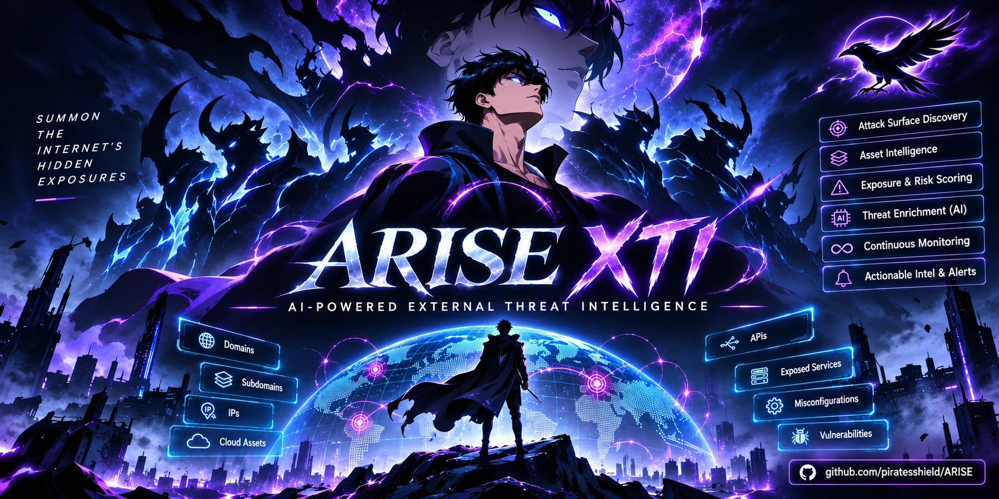

# ARISE-XTI — AI-Powered Intelligent Attack Surface Management

**A**utonomous **R**econ, **I**ntelligence, **S**ecurity & **E**xposure — an AI-powered intelligent Attack Surface Management platform.

ARISE-XTI turns a single domain into a continuously-monitored external attack surface. A 28-module pipeline runs the full adversary workflow — discovery, enumeration, fingerprinting, web/API/cloud exploitation, OSINT and intel enrichment — then an autonomous AI pentester (**AriseAI**) reasons over every piece of evidence, ranks attack hypotheses, chains them into CAPEC v3.9 / MITRE ATT&CK kill chains and live-verifies the top candidates. Everything lands in a single Flask dashboard with KEV/EPSS-blended exploitability ranking, L0–L6 evidence ladder, SLA clocks and asset-ledger diffing.

**What makes ARISE-XTI different**
- **AI-first triage** — AriseAI reads every scan artifact, picks the highest-signal hypotheses and verifies them against the real target before anything is marked "confirmed".
- **Evidence-driven** — zero AI-only findings. Every proven issue carries a baseline-vs-attack diff you can replay as `curl`.
- **Full stack coverage** — web, API, cloud, TLS, SBOM, DNS, MCP/AI surface, Shodan/Censys/GreyNoise enrichment, autonomous red-team emulation.
- **Operator-ready** — KEV/EPSS priority, SLA tracking, saved views, CSV/JSON export, Slack hand-off.

---

## Table of Contents

- [Dashboards](#-dashboards)
- [Quick Start](#-quick-start)
- [Installation](#-installation)
- [How to Use](#-how-to-use)
  - [Running the Dashboard](#1-running-the-dashboard)
  - [Running a Scan](#2-running-a-scan)
  - [Reviewing Results](#3-reviewing-results)
  - [AriseAI Red Team Pentesting](#4-ariseai-red-team-pentesting)
  - [Attack Path Analysis](#5-attack-path-analysis)
  - [Incremental & Selective Scans](#6-incremental--selective-scans)
  - [Exporting & Reporting](#7-exporting--reporting)
- [Pipeline Modules](#-pipeline-modules)
- [API Keys & Secrets](#-api-keys--secrets)
- [Configuration Reference](#-configuration-reference)
- [Repo Layout](#-repo-layout)
- [Acknowledgements](#-acknowledgements)
- [License](#-license)

---

## 📸 Dashboards

| | |
|---|---|
| **Overview** — risk score, attack chains, asset ribbon | **Issues** — KEV/EPSS-ranked, SLA-tracked |
| 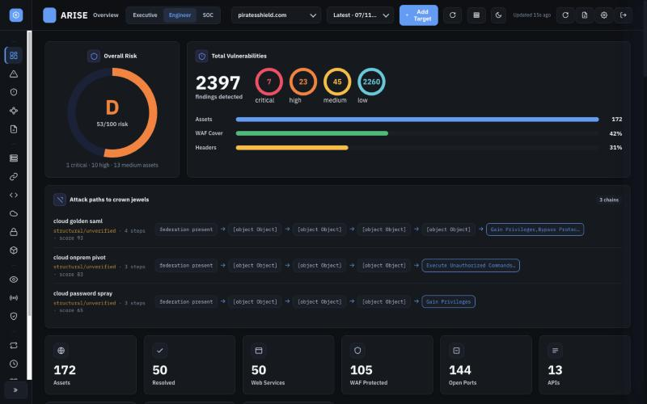 | 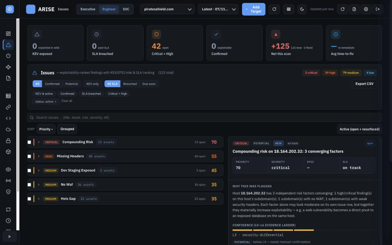 |
| **Attack Surface** — adversary-perspective inventory | **Attack Paths** — CAPEC chains to crown jewels |
| 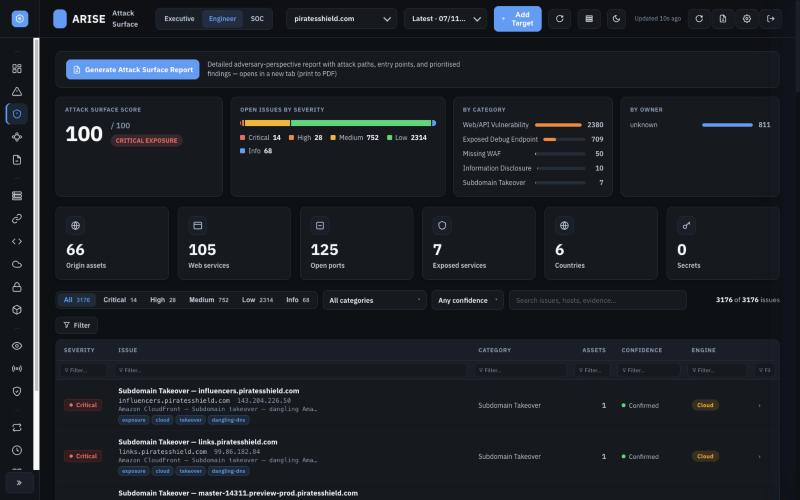 | 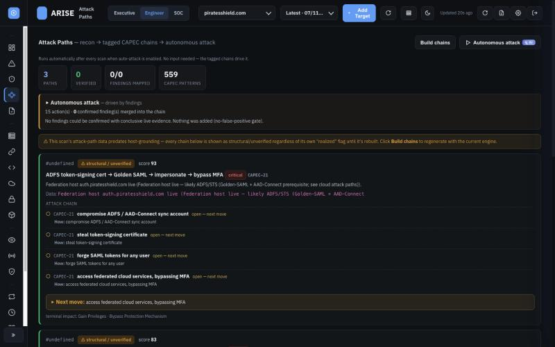 |
| **CVEs** — KEV/EPSS-blended | **Assets** — all hosts, IPs, WAF/CDN posture |
| 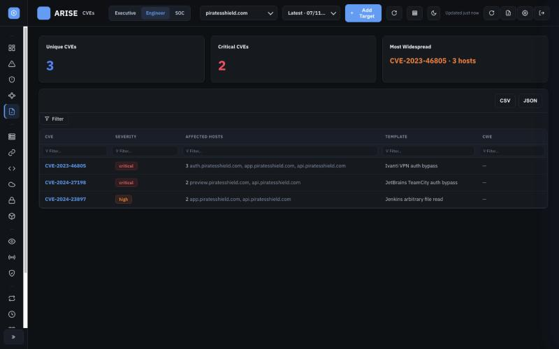 | 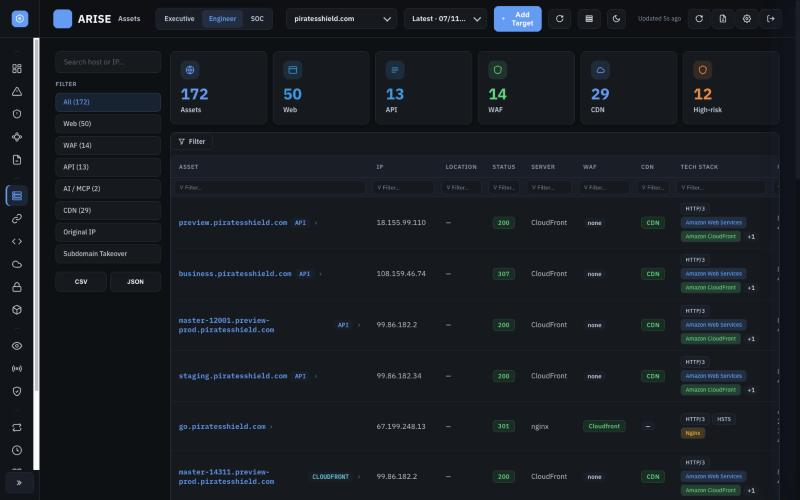 |
| **URL Inventory** — classified endpoints | **API Security** — BOLA/BFLA with evidence ladder |
| 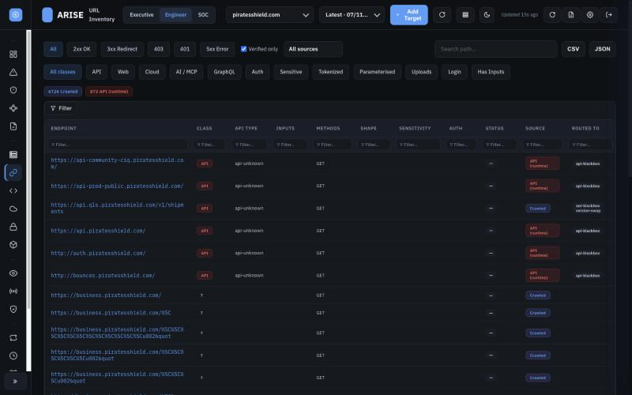 | 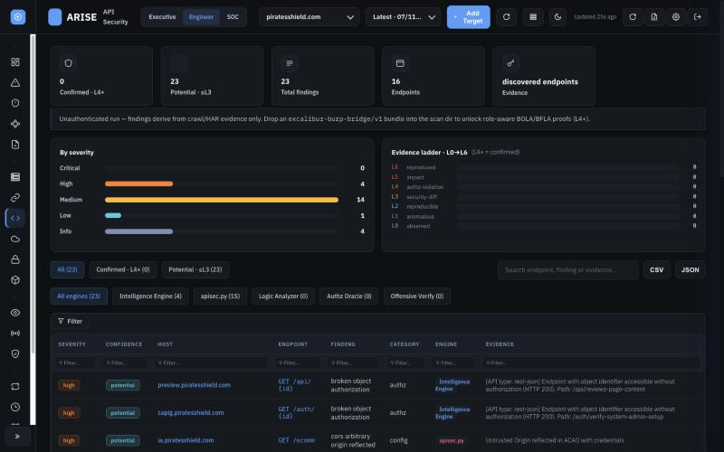 |
| **Cloud** — AWS/GCP/Azure + takeover chain | **SSL / TLS** — SSL-Labs-style per-host grades |
| 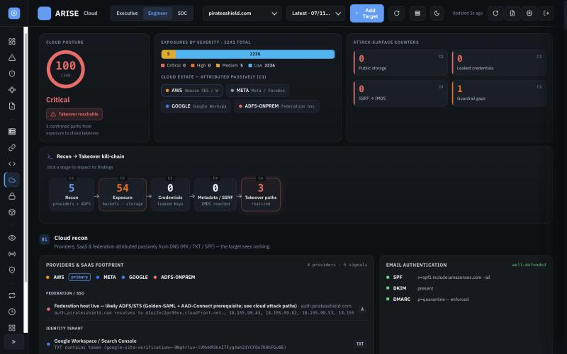 | 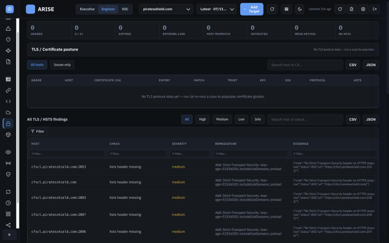 |
| **SBOM** — components × versions × hosts | **OSINT** — brand, breach, code, impersonation |
| 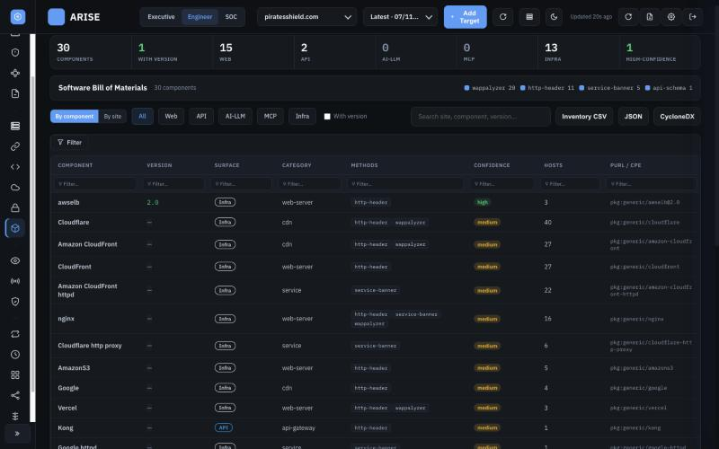 | 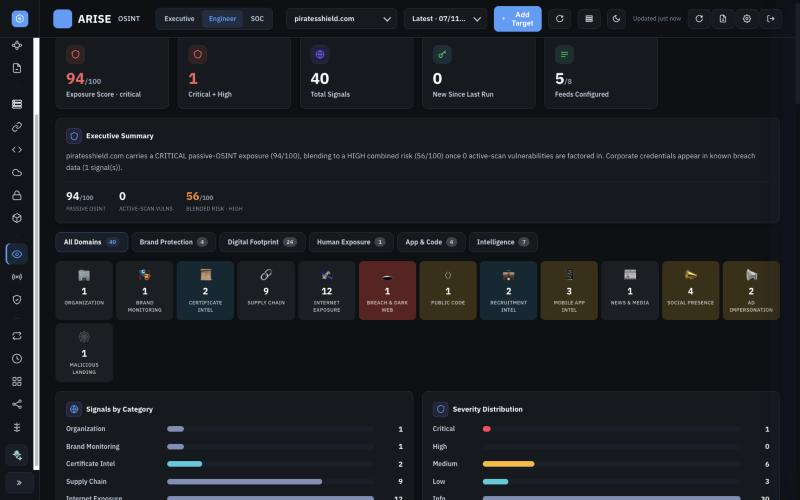 |
| **Shodan** — external-view correlation | **Red Team** — AriseAI autonomous pentester |
| 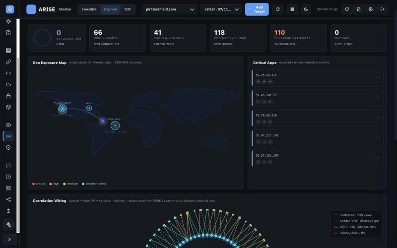 | 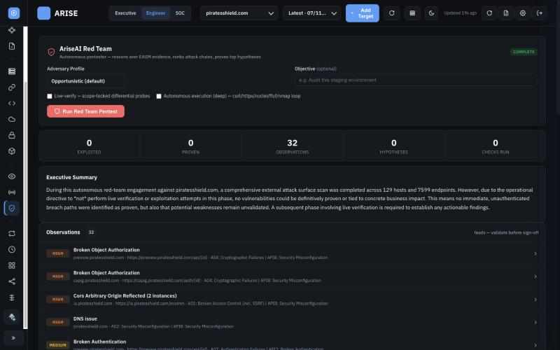 |
| **Changes** — asset / port / finding diff | |
| 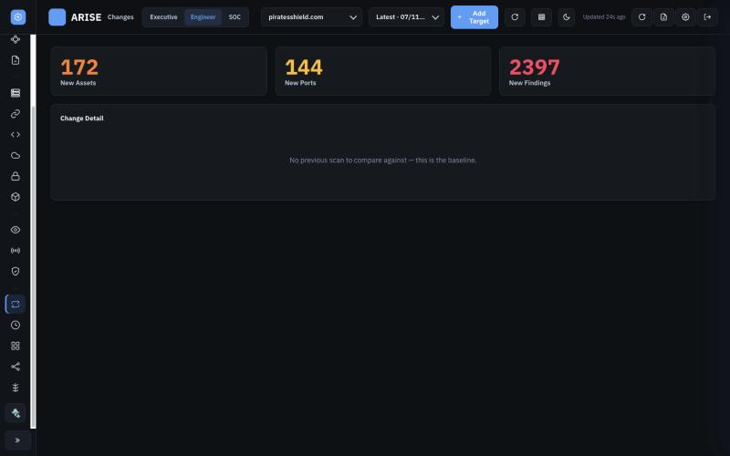 | |

---

## ⚡ Quick Start

### 🐳 Docker (fastest — 30 seconds)

```bash
docker run -d --name arisexti -p 5059:5059 \
  -v arisexti-scans:/app/scans \
  -v arisexti-state:/app/state \
  piratesshield/arisexti:latest
```

Open **http://localhost:5059** → log in with `admin` / `admin`.

Image: [`piratesshield/arisexti`](https://hub.docker.com/r/piratesshield/arisexti) on Docker Hub.

### 🖥️ Native install

```bash
./setup.sh                                          # one-shot installer (macOS/Linux)
./easm-pipeline.sh example.com                      # run a scan
python3 dashboard.py                                # open http://localhost:5059
```

**Default login:** `admin` / `admin` — change `ARISE_ADMIN_PASSWORD` before exposing the dashboard.

---

## 🔧 Installation

Pick one of the three paths below.

### Option A — 🐳 Docker (recommended)

The official image on Docker Hub ships every binary (`subfinder`, `nuclei`, `naabu`, `katana`, `dnsx`, `puredns`, `massdns`, `nmap`, Chromium for Playwright, etc.) — no local Go toolchain, no `brew`/`apt`, no PATH fights.

```bash
# Pull the latest build
docker pull piratesshield/arisexti:latest

# Run the dashboard (host port 5059)
docker run -d --name arisexti \
  -p 5059:5059 \
  -v arisexti-scans:/app/scans \
  -v arisexti-state:/app/state \
  piratesshield/arisexti:latest

# Open http://localhost:5059 (admin / admin)
docker logs -f arisexti
```

**With API keys** (recommended — enables AI analyst, Shodan, Censys, etc.):

```bash
docker run -d --name arisexti \
  -p 5059:5059 \
  -v arisexti-scans:/app/scans \
  -v arisexti-state:/app/state \
  -e ARISE_ADMIN_PASSWORD='change-me' \
  -e ARISE_SECRET='<your-fernet-key>' \
  -e ANTHROPIC_API_KEY='sk-ant-...' \
  -e SHODAN_API_KEY='...' \
  -e CENSYS_API_ID='...' -e CENSYS_API_SECRET='...' \
  piratesshield/arisexti:latest
```

**Run a scan from the host:**

```bash
docker exec -it arisexti ./easm-pipeline.sh example.com
```

**docker-compose:**

```yaml
# docker-compose.yml
services:
  arisexti:
    image: piratesshield/arisexti:latest
    container_name: arisexti
    ports:
      - "5059:5059"
    volumes:
      - arisexti-scans:/app/scans
      - arisexti-state:/app/state
    env_file: .env
    restart: unless-stopped

volumes:
  arisexti-scans:
  arisexti-state:
```

```bash
docker compose up -d
```

Image tags:
| Tag | Purpose |
|---|---|
| `piratesshield/arisexti:latest` | Latest stable |
| `piratesshield/arisexti:v1.0.0` | Pinned release |

→ https://hub.docker.com/r/piratesshield/arisexti

### Option B — 🖥️ Native install (macOS / Linux / WSL)

#### Prerequisites

- **Python 3.10+**
- **Go 1.21+** (for ProjectDiscovery tools)
- **Nmap**
- **libpcap-dev** (for naabu)

#### Install

```bash
git clone https://github.com/piratesshield/Arise-XTI.git ARISE-XTI
cd ARISE-XTI

# Run the setup script — installs all dependencies
chmod +x setup.sh
./setup.sh
```

The setup script handles:
- Python packages from `requirements.txt`
- Go tools: subfinder, httpx, nuclei, katana, naabu, dnsx, puredns
- MassDNS compilation from source
- Playwright/Chromium for headless browser modules (Module 20)
- macOS extended-attribute cleanup (`com.apple.provenance`)

#### Verify (macOS)

```bash
./verify_mac_deps.sh
```

### Option C — 🏗️ Build the image yourself

```bash
git clone https://github.com/piratesshield/Arise-XTI.git
cd Arise-XTI
docker build -t arisexti:dev .
docker run -d -p 5059:5059 arisexti:dev
```

---

## 📖 How to Use

### 1. Running the Dashboard

```bash
# Default (port 5059)
python3 dashboard.py

# Custom port
ARISE_DASHBOARD_PORT=8080 python3 dashboard.py

# With custom credentials
ARISE_ADMIN_USER=admin ARISE_ADMIN_PASSWORD=strongpass python3 dashboard.py
```

Open `http://localhost:5059` in your browser and log in. The dashboard is the central hub — all scan results, findings, and controls are accessed here.

### 2. Running a Scan

#### From the CLI

```bash
# Full scan against a target domain
./easm-pipeline.sh example.com

# Custom output directory
./easm-pipeline.sh example.com -o ./scans/my-scan

# Skip slow modules
./easm-pipeline.sh example.com -s param_fuzzing -s sqli_testing

# Fast port scan (top 1000 ports instead of default 100)
PORT_SCAN_MODE=fast ./easm-pipeline.sh example.com

# Full port scan (all 65535 ports — takes 1-2 hours)
PORT_SCAN_MODE=full ./easm-pipeline.sh example.com

# Passive only — no DNS brute-force, no active probing
PUREDNS_ENABLED=false ./easm-pipeline.sh example.com

# Lower bandwidth usage (useful on Wi-Fi / shared networks)
PUREDNS_RATE_LIMIT=50 NAABU_RATE=1000 ./easm-pipeline.sh example.com
```

#### From the Dashboard

1. Click **+ Add Target** in the top navigation bar
2. Enter the target domain (e.g., `example.com`)
3. Configure scan options — mode, modules to skip, port scan depth
4. Click **Run Scan**
5. Switch to the **Modules** tab to watch live progress — each module lights up as it runs, with a streaming log viewer

#### What happens during a scan

The pipeline runs 28 modules sequentially:

```
Asset Discovery → Subdomain Enum → DNS Resolution → HTTP Probing → WAF Detection
→ Header Analysis → Service Fingerprint → Directory Discovery → Web Crawling
→ Secret Scanning → Parameter Fuzzing → Nuclei Scanning → XSS Testing
→ SQL Injection → Cloud Exposure → OSINT → Shodan → Internet Intel
→ Offensive Verification → Attack Paths → AriseAI Red Team → Reporting
```

Each module writes structured output (JSONL/JSON) to the scan directory. The dashboard reads these files in real time — results appear as modules complete.

### 3. Reviewing Results

After a scan completes, use the dashboard views to triage findings:

#### Issues (main triage view)

The **Issues** tab is the primary triage interface:
- Findings are ranked by **exploitability** — KEV (Known Exploited Vulnerabilities) and EPSS (Exploit Prediction Scoring) badges show real-world risk
- **SLA clocks** track time-to-remediate by severity
- **Confidence levels** (L0–L6): exposed-service and leaked-secret are auto-confirmed; other findings carry evidence tiers
- **Saved views**: filter by severity, SLA status, confidence, then save the filter as a named view
- **CSV export** for ticketing systems

```
Filter bar: [All] [Confirmed] [Potential] [KEV only] [All SLA] [Breached] [Due soon]
Sort:       Priority (default) | Grouped by host | By severity
```

#### Attack Surface

Per-host drill-down showing what an attacker sees:
- **Ports** — open ports with service versions, CDN-vs-origin tagging
- **TLS/Cert** — SSL-Labs-style grade (A+ through F), cert chain, HSTS status
- **WAF/CDN** — detected WAF vendor, CDN provider
- **SBOM** — detected technologies with version numbers and detection method
- **Technical Evidence** — plugin output block correlating ports, TLS, WAF, and SBOM onto each finding

#### URL Inventory

All discovered endpoints (from crawling, GAU, dirsearch, parameter fuzzing, API discovery) classified into 17 URL types:
- login, admin_panel, api, graphql, file_upload, search, password_reset, registration, payment, websocket, etc.
- Click any URL class to filter; each endpoint shows its discovery source and attack routing

#### Cloud

Cloud storage exposure findings:
- S3/Azure/GCS bucket enumeration with open/closed status
- Object-level sensitive-key detection
- SSRF-to-IMDS metadata checks
- Cloud credential scanning
- SaaS fingerprinting (Salesforce, Jira, Confluence, etc.)

#### TLS/Cert Posture

Per-host SSL-Labs-style grading:
- **A+** — HSTS preloaded, strong TLS 1.3, valid cert
- **A** — HSTS enabled, TLS 1.2+, valid cert
- **B** — Missing HSTS or allows TLS 1.1
- **F** — Expired/invalid cert, weak ciphers, or SSLv3
- Inline drill-down with cert details, cipher suites, protocol support

### 4. AriseAI Red Team Pentesting

AriseAI is an autonomous AI-driven pentester that reasons over all EASM evidence, ranks attack hypotheses, and live-verifies findings.

#### Running a red team assessment

**From the dashboard:**
1. Navigate to the **Red Team** tab (left sidebar)
2. Select an **adversary profile**:
   - **Opportunistic** (default) — broad automated scanning, low-hanging fruit
   - **APT29** (Cozy Bear) — methodical, persistence-focused, credential harvesting
   - **FIN7** — financial data targeting, POS/payment systems
   - **APT28** (Fancy Bear) — aggressive, rapid exploitation
   - **Lazarus** — supply-chain and crypto targeting
3. Optionally set an **objective** (e.g., "Audit this staging environment")
4. Optionally enable **autonomous execution** (deeper, agent-driven testing)
5. Click **Run Red Team Pentest**

**From the CLI:**
```bash
# Basic red team assessment
python3 -m ai_analyst /path/to/scan/dir --target example.com --summary

# With specific adversary profile
python3 -m ai_analyst /path/to/scan/dir --target example.com --adversary apt29

# Recon-only mode (no live verification)
python3 -m ai_analyst /path/to/scan/dir --target example.com --recon-only --no-live-verify
```

#### Understanding red team results

The Red Team view shows:

- **Kill Chain Progression** — 10 ATT&CK tactical phases (Recon → Initial Access → Execution → Persistence → Priv Esc → Defense Evasion → Credential Access → Discovery → Lateral Movement → Collection) with breach-path visualization

- **Proven Findings** — differential-confirmed vulnerabilities. Click any row to expand:
  - **Impact** — what an attacker gains
  - **Request Sent** — the exact HTTP request with bypass payload
  - **Response** — baseline vs attack comparison (HTTP status, headers, body excerpt)
  - **Fix** — remediation guidance
  - **Replay PoC** / **Copy curl** — reproduce the finding

- **Observations** — unconfirmed signals that warrant manual investigation

- **Hypotheses** — ranked attack theories the AI evaluated and why each was pursued or dropped

- **Coverage** — which live checks ran and their results

#### Evidence-first policy

AriseAI follows strict evidence rules:
- Findings are **never** marked CONFIRMED based solely on status-code changes, response-length differences, or AI inference
- Every proven finding requires **differential confirmation**: a baseline request and an attack request with verifiable differences
- Scanner output is treated as untrusted evidence, not ground truth
- If evidence is missing or contradictory, the finding is classified as INCONCLUSIVE

### 5. Attack Path Analysis

The **Attack Paths** tab shows CAPEC v3.9-based attack chains:

- Each path chains prerequisites → attack steps → impact
- **Three-tier evidence model**: confirmed (live-verified), observed (scanner-detected), recon (passive signals)
- Paths connect discovered weaknesses to potential crown-jewel compromises
- Cloud-specific paths require minimum evidence tiers to prevent false chains

To generate attack paths:
1. Run a scan (paths are generated automatically as Module 25)
2. Navigate to the **Attack Paths** tab
3. Click **Build Attack Paths** to regenerate with latest findings

### 6. Incremental & Selective Scans

#### Incremental mode

Runs a full scan but compares results against the **asset ledger** — a persistent record of known assets. New findings are flagged as NEW or RESURFACED.

```bash
./easm-pipeline.sh example.com --mode incremental
```

The **Changes** tab in the dashboard shows the delta: new subdomains, new ports, new findings, and removed assets.

#### Selective mode

Re-runs only specific modules against the last scan's data, without re-doing discovery:

```bash
# Re-run only API security checks
./easm-pipeline.sh example.com --only api_security

# Re-run injection testing
./easm-pipeline.sh example.com --only sqli_testing --only xss_testing

# Re-run cloud exposure checks
./easm-pipeline.sh example.com --only cloud_exposure

# Re-run the AI red team assessment
./easm-pipeline.sh example.com --only ariseai
```

Available module names for `--only` / `--skip`:

`asset_discovery` · `subdomain_enum` · `dns_resolution` · `dns_security` · `http_discovery` · `waf_detection` · `header_analysis` · `service_fingerprint` · `directory_discovery` · `crawling` · `secret_scanning` · `param_fuzzing` · `nuclei_scan` · `xss_testing` · `sqli_testing` · `api_security` · `full_port_scan` · `shodan_correlation` · `internet_intel` · `cloud_exposure` · `osint_intel` · `reporting`

### 7. Exporting & Reporting

#### CSV Export

From the **Issues** tab, click **Export CSV** to download all findings (respects active filters and saved views).

#### JSON Report

Each scan generates a consolidated report at `scans/<target>-<ts>/reports/report.json`.

#### Slack Integration

Send scan summaries to Slack:
1. Go to **Settings** → paste your Slack webhook URL
2. After a scan completes, click the Slack icon to send a summary
3. Or enable auto-summary to post automatically after every scan

---

## 🔬 Pipeline Modules

| # | Module | Description |
|---|--------|-------------|
| 1 | Asset Discovery | Subdomain enumeration via subfinder (passive sources) |
| 2 | Subdomain Enumeration | Active DNS brute-force via puredns + massdns |
| 3 | DNS Resolution | Resolve hosts, filter CDN IPs, DoH fallback when system DNS fails |
| 3B | DNS Discovery | Full zone enumeration, authoritative NS, SOA audit |
| 3C | DNS Security Audit | DNSSEC validation, SPF/DKIM/DMARC, wildcard detection |
| 4 | HTTP Discovery | httpx probing + naabu port scanning |
| 5 | WAF Detection | wafw00f fingerprinting + baseline calibration |
| 6 | Header Analysis | Security header scoring (CSP, HSTS, X-Frame, etc.) |
| 7 | Service Fingerprinting | Non-HTTP service identification via nmap |
| 8 | Directory Discovery | dirsearch with WAF-aware rate limiting + 403 bypass |
| 8B | Endpoint Consolidation | Merge all URL sources into unified classified inventory |
| 8C | HRS Surface Assessment | HTTP Request Smuggling safe indicators |
| 8D | MCP/AI Surface Probe | Discover MCP servers and AI/LLM endpoints |
| 9 | Web Crawling | katana deep crawl + GAU/Wayback URL harvesting |
| 10 | Secret Scanning | TruffleHog credential detection |
| 10.1 | NLP Content Scan | PII, disclosure, and secret detection in JS files and HTTP responses |
| 11 | Parameter Fuzzing | Parameter discovery and input mapping |
| 12 | Nuclei Scanning | Dual-phase: broad sweep + tech-detected deep scan |
| 13 | XSS Testing | dalfox cross-site scripting detection |
| 15 | SQL Injection | sqlmap with WAF-aware safe detection + time caps |
| 17 | Cloud Exposure | S3/Azure/GCS enum, SSRF-to-IMDS, cloud posture, SaaS fingerprint |
| 18 | OSINT Intelligence | Breach/exposure/brand signal collection |
| 19+24 | Offensive Verification | Unified active exploitation (19+ check types): JWT, GraphQL, SSTI, CRLF, redirect, SSRF, proto-pollution, cache-poison, race, CSWSH — all differential-confirmed |
| 20 | API Deep Discovery | Headless Chrome/CDP interception, form/upload detection, method enumeration |
| 20.1 | API SQL Injection | sqlmap on discovered API endpoints |
| 20.2 | Input Discovery | CDP-driven input-function mapping |
| 21 | Subdomain Takeover | subjack takeover detection |
| 22 | Shodan Correlation | External-view port/service enrichment |
| 23 | Internet Intel | Consolidated enrichment (Censys, GreyNoise) |
| 26 | Response Intelligence | NLP passive analysis of HTTP 200 responses for PII/secrets/disclosure |
| 27 | Adaptive Loop | Per-endpoint attack FSM (observe → classify → hypothesize → fire → verify → chain) |
| 28 | AriseAI Red Team | Autonomous AI-driven pentesting with kill chain mapping |
| 14 | Reporting | Final consolidated report generation |

---

## 🔑 API Keys & Secrets

All keys are read from environment variables (export in your shell, `.env`, or `~/.zshrc`).
They can also be pasted into **Settings → API Keys** in the dashboard — the vault is encrypted at rest with `ARISE_SECRET`.

### Mandatory

| Key | Purpose |
|---|---|
| `ARISE_ADMIN_USER` | Dashboard login username. **Default: `admin`** |
| `ARISE_ADMIN_PASSWORD` | Dashboard login password. **Default: `admin`** (change before any public deployment). |
| `ARISE_SECRET` | Fernet key that encrypts the on-disk secrets vault (`secrets.enc.json`). |

### Optional — AI Analyst / Red Team

At least **one** provider key is required for the AI Analyst and Red Team tabs to run; otherwise they show a "key required" banner.

| Key | Enables |
|---|---|
| `ANTHROPIC_API_KEY` | Claude (recommended for AriseAI pentester). |
| `OPENAI_API_KEY` | GPT models. |
| `GEMINI_API_KEY` *(or `GOOGLE_API_KEY`)* | Google Gemini (default provider). |

### Optional — External Intel

Each key unlocks the matching dashboard tab without blocking the rest of the pipeline.

| Key | Enables |
|---|---|
| `SHODAN_API_KEY` | **Shodan** tab — external-view enrichment, coverage-gap ports, geo exposure map. |
| `CENSYS_API_ID` + `CENSYS_API_SECRET` | **Internet Intel** — TLS/services from Censys. |
| `GREYNOISE_API_KEY` | Background-noise scoring in Internet Intel. |
| `VIRUSTOTAL_API_KEY` | Passive DNS / subdomain enrichment. |
| `INTELX_API` | IntelX breach & paste search in OSINT. |
| `GITHUB_TOKEN` | OSINT — GitHub code / secret hunting (unauthenticated is rate-limited). |

### Optional — Notifications & Infra

| Key | Enables |
|---|---|
| `SLACK_WEBHOOK` | One-click scan-summary / finding export to Slack. |
| `ARISE_DASHBOARD_PORT` | Override default port (`5059`). |

### Example `.env`

```bash
# --- mandatory ---
ARISE_ADMIN_USER=admin
ARISE_ADMIN_PASSWORD=strongpassword    # CHANGE before exposing the dashboard
ARISE_SECRET=$(python3 -c "from cryptography.fernet import Fernet; print(Fernet.generate_key().decode())")

# --- AI (pick one) ---
ANTHROPIC_API_KEY=sk-ant-...
# OPENAI_API_KEY=sk-...
# GEMINI_API_KEY=AIza...

# --- intel ---
SHODAN_API_KEY=...
CENSYS_API_ID=...
CENSYS_API_SECRET=...
GREYNOISE_API_KEY=...

# --- notify ---
SLACK_WEBHOOK=https://hooks.slack.com/services/...
```

---

## ⚙️ Configuration Reference

### Environment Variables

| Variable | Default | Description |
|----------|---------|-------------|
| `ARISE_DASHBOARD_PORT` | `5059` | Dashboard HTTP port |
| `ARISE_DASHBOARD_HOST` | `127.0.0.1` | Dashboard bind address |
| `ARISE_ADMIN_USER` | `admin` | Dashboard login username |
| `ARISE_ADMIN_PASSWORD` | `admin` | Dashboard login password |
| `ARISE_DASHBOARD_DEBUG` | `0` | Enable Flask debug mode |
| `ARISE_AI_PROVIDER` | `gemini` | AI provider: `gemini`, `openai`, `anthropic` |
| `ARISE_AI_MODEL` | (provider default) | AI model override |
| `PORT_SCAN_MODE` | `default` | Port scan scope: `fast` (top 1000), `default` (top 100), `full` (65535) |
| `NAABU_RATE` | `3000` | Port scan packets/sec |
| `NAABU_THREADS` | `100` | Port scan concurrent threads |
| `PUREDNS_ENABLED` | `true` | Enable active DNS brute-force in Module 2 |
| `PUREDNS_RATE_LIMIT` | `100` | DNS queries/sec for public resolvers |
| `CLOUD_ORIGIN_MAX` | `25` | Max protected hosts for origin-bypass testing |
| `ARISE_LEDGER` | `1` | Enable asset ledger tracking (`0` to disable) |
| `ARISE_ATTACK_CHAIN_V2` | `0` | Enable v2 attack chain analysis |

### Scan modes

| Mode | Flag | Description |
|------|------|-------------|
| **Full** | `-m full` (default) | Complete scan from scratch. Refreshes the asset ledger. |
| **Incremental** | `-m incremental` | Full run + emits delta (new/changed assets) vs the asset ledger. |
| **Selective** | `-m selective` | Run only `--only` modules against the last scan snapshot. |

---

## 🧠 What Runs Under the Hood

28-module pipeline — *asset discovery → DNS → HTTP probe → WAF → service fingerprint → directory discovery → crawling → JS mining → secret scanning → param fuzzing → nuclei → XSS/SQLi/LFI → port scan → **API Security** → **Cloud Exposure** → OSINT → **Shodan** → **Internet Intel** → **Advanced Attacks (offensive_verify)** → **Attack Paths (CAPEC v3.9)** → **AriseAI Analyst***.

Every finding carries an **L0–L6 evidence ladder** (observed → security-differential → reproducible → authz-violation → impact → reproduced) and feeds the **exploitability-first Issues** view with KEV / EPSS / SLA tracking.

---

## 🛠 Tooling

Recon: `subfinder`, `puredns`, `massdns`, `dnsx`, `httpx`, `naabu`, `nmap` · Crawl: `katana`, `gospider`, `gau`, `waybackurls` · Content: `dirsearch`, `ffuf`, `wappalyzer` · JS: `subjs`, `getJS`, `linkfinder`, `secretfinder`, `trufflehog` · Fuzzing: `ffuf`, `arjun`, `paramspider` · CVE: `nuclei` · Cloud: `cloud_nuclei`, `cloud_enum`, `s3-recon` · API: native `apisec.py`, headless CDP · Attack: `offensive_verify.py`, `adaptive_loop.py`, `capec_attack_paths.py`.

---

## 📁 Repo Layout

```
ARISE-XTI/
├── easm-pipeline.sh           # Main 28-module scan orchestrator
├── dashboard.py               # Flask dashboard server (119 routes, 15+ views)
├── arise_jobs.py              # Job runner and scheduler
├── arise_autonomous.py        # Autonomous scan coordination
├── setup.sh                   # One-shot installer (macOS/Linux/WSL/Docker)
├── verify_mac_deps.sh         # macOS dependency checker
├── requirements.txt           # Python dependencies
│
├── templates/
│   └── dashboard.html         # Single-page dashboard UI
│
├── recon/                     # Subdomain enum, DNS, IP geo, tech stack detection
├── discovery/                 # URL classification, endpoint consolidation, SBOM, MCP/AI probe
├── ports/                     # Port scanning, CDN/origin split
├── tls/                       # HSTS audit, TLS/cert posture grading
├── cloud/                     # Cloud storage enum, credential scan, SSRF, SaaS fingerprint
├── offensive/                 # Offensive verification, adaptive loop, finding reconciler
├── api_security/              # API intelligence engine, passive analyzers
├── intel/                     # CAPEC paths, Shodan, internet intel, OSINT, KEV/EPSS
├── evidence/                  # Evidence provenance, nuclei FP filter
├── ai_analyst/                # AriseAI autonomous red-team pentester
├── ai/                        # NLP engine (PII/secret/disclosure detection)
├── history/                   # Asset ledger, entity tracking, issue lifecycle
├── core/                      # Networking, AI provider, session jar, crypto
│
├── scans/                     # Scan output directories (per target + timestamp)
│   └── example.com-011126-0145/
│       ├── subdomains.txt
│       ├── http_hosts.txt
│       ├── web_ports.jsonl
│       ├── discovered_endpoints.jsonl
│       ├── nuclei_findings.jsonl
│       ├── tls_posture.jsonl
│       ├── sbom.jsonl
│       ├── 28_ai_analyst/
│       │   ├── ai_analyst_result.json
│       │   └── findings/
│       └── reports/report.json
│
├── lists/                     # Wordlists for brute-force and fuzzing
├── tools/                     # External tool binaries
├── scope/                     # Scope definition files
├── tests/                     # Test suite
└── screenshots/               # Dashboard captures
```

---

## 🙏 Acknowledgements

ARISE-XTI stands on the shoulders of a brilliant open-source security community. We're deeply grateful to every project below — without them this platform would not exist.

### Special thanks — inspiration

- **[Strix](https://github.com/usestrix/strix)** — the open-source AI hacker / autonomous AI-driven pentester that inspired the **AriseAI** red-team module. Strix proved that an LLM agent could reason over a target, propose hypotheses and live-verify findings end-to-end; AriseAI borrows that evidence-first philosophy and applies it on top of the ARISE EASM pipeline. Thank you for showing the way. 🫡

### Core recon & discovery

- **[ProjectDiscovery](https://github.com/projectdiscovery)** — `subfinder`, `httpx`, `nuclei`, `katana`, `naabu`, `dnsx` — the backbone of modern recon tooling.
- **[puredns](https://github.com/d3mondev/puredns)** + **[massdns](https://github.com/blechschmidt/massdns)** — high-throughput DNS resolution and brute-force.
- **[nmap](https://nmap.org/)** — port scanning and service fingerprinting (NSE scripts).
- **[wafw00f](https://github.com/EnableSecurity/wafw00f)** — WAF fingerprinting.
- **[gau](https://github.com/lc/gau)** / **[waybackurls](https://github.com/tomnomnom/waybackurls)** — URL harvesting from public archives.
- **[gospider](https://github.com/jaeles-project/gospider)** / **[subjs](https://github.com/lc/subjs)** / **[getJS](https://github.com/003random/getJS)** — crawling and JavaScript collection.

### Content & endpoint discovery

- **[dirsearch](https://github.com/maurosoria/dirsearch)** — directory and file brute-force.
- **[ffuf](https://github.com/ffuf/ffuf)** — fast web fuzzer.
- **[arjun](https://github.com/s0md3v/Arjun)** / **[paramspider](https://github.com/devanshbatham/ParamSpider)** — parameter discovery.
- **[linkfinder](https://github.com/GerbenJavado/LinkFinder)** / **[secretfinder](https://github.com/m4ll0k/SecretFinder)** — endpoint & secret mining in JS.
- **[wappalyzer](https://www.wappalyzer.com/)** — technology fingerprinting.
- **[Playwright](https://playwright.dev/)** + **CDP** — headless browser-driven API/input discovery.

### Vulnerability detection & exploitation

- **[nuclei-templates](https://github.com/projectdiscovery/nuclei-templates)** — the community template library that powers Module 12.
- **[dalfox](https://github.com/hahwul/dalfox)** — XSS detection.
- **[sqlmap](https://github.com/sqlmapproject/sqlmap)** — SQL injection.
- **[subjack](https://github.com/haccer/subjack)** — subdomain takeover detection.
- **[trufflehog](https://github.com/trufflesecurity/trufflehog)** — secret / credential scanning.

### Cloud & supply chain

- **[cloud_enum](https://github.com/initstring/cloud_enum)** — multi-cloud resource enumeration.
- **[s3-recon](https://github.com/clody23/s3-recon)** patterns — S3 misconfiguration discovery.
- **[CycloneDX](https://cyclonedx.org/)** — SBOM schema.

### Intelligence & enrichment

- **[Shodan](https://www.shodan.io/)** — external-view port & service enrichment.
- **[Censys](https://censys.io/)** — TLS, service and certificate intelligence.
- **[GreyNoise](https://www.greynoise.io/)** — background-noise scoring.
- **[CISA KEV](https://www.cisa.gov/known-exploited-vulnerabilities-catalog)** — Known Exploited Vulnerabilities catalog.
- **[FIRST EPSS](https://www.first.org/epss/)** — Exploit Prediction Scoring System.

### Standards, taxonomy & research

- **[OWASP](https://owasp.org/)** — WSTG v4.1, API Top 10, ASVS, Testing Guide.
- **[MITRE ATT&CK](https://attack.mitre.org/)** — adversary tactics and techniques.
- **[MITRE CAPEC v3.9](https://capec.mitre.org/)** — Common Attack Pattern Enumeration — powers the Attack Paths view.
- **[MITRE CWE](https://cwe.mitre.org/)** — Common Weakness Enumeration.

### Libraries & plumbing

- **[Flask](https://flask.palletsprojects.com/)** — the dashboard web framework.
- **[Werkzeug](https://werkzeug.palletsprojects.com/)** — WSGI + PBKDF2 password hashing.
- **[cryptography](https://cryptography.io/)** / **[Fernet](https://cryptography.io/en/latest/fernet/)** — encrypted secret vault.
- **[requests](https://requests.readthedocs.io/)**, **[httpx](https://www.python-httpx.org/)**, **[aiohttp](https://docs.aiohttp.org/)** — HTTP clients.
- **[certifi](https://github.com/certifi/python-certifi)** — trusted CA bundle.
- **[Playwright](https://playwright.dev/python/)** — headless Chromium automation.

### AI providers

- **[Anthropic Claude](https://www.anthropic.com/)** — default AriseAI reasoning engine.
- **[OpenAI](https://openai.com/)** — GPT-family support.
- **[Google Gemini](https://ai.google.dev/)** — Gemini provider support.

### The security community

Finally, a massive thank-you to every bug-bounty hunter, CTF author, red-teamer, blue-teamer, academic researcher and open-source maintainer whose write-ups, tools, templates and talks shaped the heuristics inside ARISE-XTI. This project is a love letter to that community.

If you maintain a project listed above and would like different attribution — or you believe your work should be credited and isn't — please open an issue and we'll fix it right away.

---

## 📜 License

Commercial — Piratesshield. Contact for evaluation licenses.
